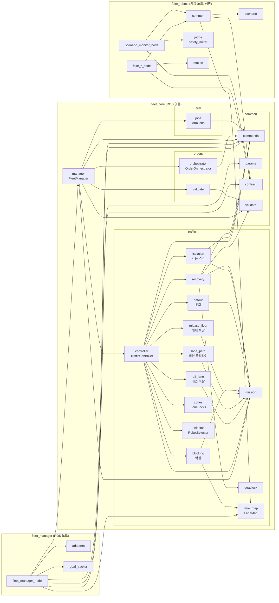
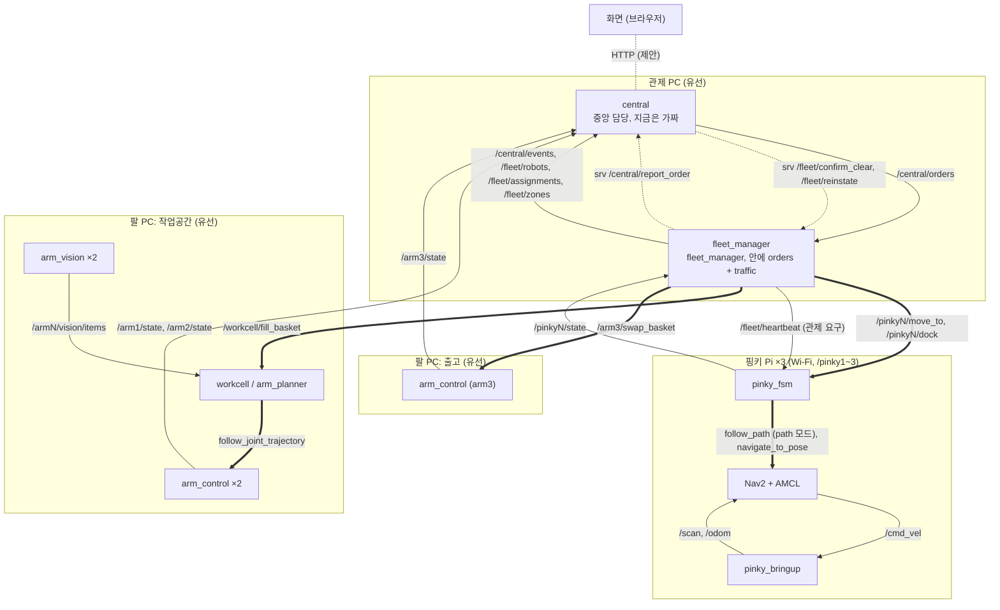

# GG 주문 피킹 관제 프로토타입

심화 16기 2팀 GG 프로젝트의 관제를 실물 없이 개발하고 시험하기 위한 프로토타입입니다. 주문이 들어오면 핑키가 대기 구간에서 출발하고, 공유 작업공간의 로봇팔 2대가 핑키 뒤 트레이의 바구니에 주문 상품을 담습니다. 핑키가 출고 구역으로 가면 로봇팔 1대가 바구니째 꺼내고 빈 바구니를 트레이에 넣습니다. 그다음 핑키는 대기 구간으로 돌아가거나, 주문이 밀려 있으면 바로 작업공간으로 갑니다.

**이 저장소의 모든 결과는 가짜 로봇으로 얻은 것입니다.** 실물 핑키, 실물 로봇팔, 실제 카메라로 시험한 적이 없으므로 시간, 정밀도, 그리퍼 성능에 대해서는 아무것도 말해 주지 않습니다.

폴더 구조는 `04_GitHub_저장소_구성안.pdf`를 따릅니다. 인터페이스, 지도, 수치는 아직 팀 합의 전의 초안이며 작업공간 위치도 미정입니다.

FMS(fleet manager, RCS)는 핑키 플릿에 일을 나눠 주고(배분), 길을 정리하고(교통), 스테이션에 작업을 요청합니다(핸드셰이크). 팔의 동작 자체는 스테이션이 합니다. FMS는 프로세스 하나이고, 안에 `orders`와 `traffic` 두 모듈이 있습니다.

### 모듈 의존성 (누가 누구를 import하나)



`orders`, `arm`, `traffic`은 서로 import하지 않고, `manager`가 `common/commands.py`의 명령으로 셋 사이를 잇습니다. `orders`가 위에서 정해 `traffic`(로봇 이동)과 `arm`(fill, swap goal)에 요청합니다. `pc/fleet_core/test/test_fms_boundary.py`가 이 경계를 검사합니다. `traffic`은 주문과 바구니를 모르고, `arm`은 받은 주문 ID와 품목을 goal에 실어 보낼 뿐 주문 진행과 바구니 상태를 판단하지 않습니다.

### ROS 노드 지도 (컴퓨터별)



실선은 토픽, 점선은 서비스, 굵은 선은 액션입니다. 시험 때는 같은 인터페이스를 내는 가짜 노드(`fake_robots`의 `fake_pinky_node` ×3, `fake_workcell_node`, `fake_arm_node`, `fake_vision_node`, `fake_central_node`)와 심판 `scenario_monitor_node`, `sim_clock_node`가 관제 PC에서 대신 뜹니다. 11-06에 더한 `/fleet/reinstate`(파트 6), `MoveTo`의 `path`(파트 7), 상태 값 `BLOCKED`(파트 4)가 들어갔습니다. `follow_path`와 `navigate_to_pose`는 핑키 안의 Nav2 액션이고 `contract.yaml`에 `real_only`로 있습니다. 0.3에 더한 것은 모두 관제 요구(팀 합의 전)입니다. 이름, 타입, QoS의 원본은 `interfaces/fleet_interfaces/contract.yaml`입니다.

## 폴더

| 폴더 | 내용 | 상태 |
|---|---|---|
| `interfaces/fleet_interfaces` | 메시지, 액션, 서비스, `contract.yaml`(이름, 타입, QoS의 단일 원본) | 초안 |
| `pc/fleet_core` | 관제 판단 로직. ROS를 쓰지 않는 순수 Python과 pytest. `manager.py`(`FleetManager`), `orders/`(주문), `arm/`(팔 작업), `traffic/`(교통), `common/`(명령, 파라미터, 계약), `data/`(기본 지도와 파라미터) | 동작 |
| `pc/fleet_manager` | `fleet_core`를 ROS에 연결하는 노드. 실행 파일 `fleet_manager_node`, 노드 이름 `fleet_manager` | 동작 |
| `sim/fake_robots`, `sim/fake_robots/scenarios` | 가짜 핑키, 작업공간 서버, 출고 팔, 비전, 중앙, 시계, 심판 노드와 시나리오 | 동작 |
| `sim/fake_robots/maps` | 비교용 지도: 일방통행 2개(`oneway_loop`, `oneway_shortcut`), 우회 시험용 특징 지도(`feature_map`), 11-06 변형 2개(`two_lane_avenue`, `two_lane_segments`). 시나리오는 `map:`으로 고른다. 기본 지도는 `pc/fleet_core/fleet_core/data/lane_map.yaml` | 동작 |
| `tools` | 전수 검사(`model_check.py`), 기록 재생(`replay.py`), 지연·잡음 압박 시험(`pressure_sweep.py`), 격자 지도 변환(`convert_grid_map.py`) | 동작 |
| `bringup/iponic_bringup` | `pc.launch.py` | 동작 |
| `scripts/check_interfaces.py` | 실행 중인 시스템을 `contract.yaml`과 비교 | 동작 |
| `pc/central`, `pinky/*`, `arm/*` | 담당자가 채울 빈 패키지 | 비어 있음 |

패키지 이름(`fleet_interfaces`, `fleet_manager`, `fleet_core`, `fake_robots`, `iponic_bringup`)은 그대로이고, 2026-11-06에 패키지 안의 모듈만 역할에 맞게 나누고 이름을 바꿨습니다. 프로젝트 이름이 정해지지 않아 패키지에 접두어를 붙이지 않았습니다. 모듈별로 바꾼 표는 `docs/worklog_2026-11-06.md`에 있습니다. 낱말은 fleet(핑키 3대), station(작업공간·출고), waypoint(지점, 레인 그래프의 꼭짓점. ROS 노드와 헷갈리지 않게 "노드"라 부르지 않습니다), lane(레인), zone(구역, 잠금 단위), dock/parking으로 씁니다.

가짜 노드는 다음과 같습니다.

| 노드 | 맡은 일 |
|---|---|
| `fake_pinky_node` | `/{pinky}/state`, `move_to`, `dock`. 고장 `comm_loss`, `nav_abort`, `stuck`, `operator_remove`, `operator_reinstate` |
| `fake_workcell_node` | `/workcell/fill_basket`, `/arm1/state`, `/arm2/state`. 고장 `arm_fail`, `arm.fail_rate` |
| `fake_arm_node` | arm3만. `/arm3/swap_basket`, `/arm3/state`. 고장 `swap_partial`, `arm.fail_rate` |
| `fake_vision_node` | `/arm1/vision/items`, `/arm2/vision/items`. 실제 재고를 보여 주고 집어 간 만큼 줄어듭니다 |
| `fake_central_node` | 재고 기록과 주문 목록, `/central/orders`, `submit_order`, `report_order`, `set_run_mode`, 중앙 이벤트 코드 |
| `scenario_monitor_node` | 심판. 결과 파일을 쓰고 launch를 끝내며, `operator_remove` 때 관리자 대신 `confirm_clear`를(코스 밖 확인 뒤 0.5초가 지나고 심판의 보유가 0.3초 그대로일 때, 늦어도 1.0초에. 시뮬레이션 초), `operator_reinstate` 때 `reinstate`를 부릅니다. 치운 뒤 `ZONES_STILL_HELD`가 오면 남은 구역을 다시 치우고, 심판이 아는 남은 구역(보유 스냅샷과 `ZONES_STILL_HELD`)이 없고 응답 뒤 2초가 지났을 때만 `reinstate`를 부릅니다(`operator_clear.py`). 알림이 그보다 늦으면 재투입이 거부될 수 있고 다시 부르지 않습니다. 다시 치워 받아들여지면 `ZONES_CLEARED`가 하나 더 나와, 그 횟수를 `event_counts`에 정한 시나리오에서는 실패로 드러납니다 |

## 실행

ROS 없이 관제 로직만 시험합니다. Windows에서도 실행할 수 있습니다.

```bash
pip install pytest pyyaml
PYTHONPATH=pc/fleet_core python -m pytest pc/fleet_core/test -q
```

ROS 2 Jazzy에서 전체를 빌드하고 시나리오를 실행합니다. 로봇 네트워크의 기본 도메인과 섞이지 않도록 도메인을 따로 지정합니다.

```bash
mkdir -p ~/fleet_ws/src && cp -r . ~/fleet_ws/src/roscamp-repo-2 && cd ~/fleet_ws
source /opt/ros/jazzy/setup.bash
colcon build
source install/setup.bash
export ROS_DOMAIN_ID=43 ROS_AUTOMATIC_DISCOVERY_RANGE=LOCALHOST

ros2 launch iponic_bringup pc.launch.py use_fake:=true scenario:=basic_orders result_dir:=/tmp/run1
cat /tmp/run1/summary.json
```

시나리오가 끝나면 launch가 스스로 종료되고, `result_dir`에 `summary.json`, `safety.json`, `events.csv`, `zones.csv`, `robots.csv`, `releases.csv`, `fleet_robots.csv`가 남습니다. 심판은 가짜 로봇이 `/sim/truth/<로봇>`으로 발행하는 잡음 없는 위치로 판정하고, 실물 로봇은 보고된 위치로 판정합니다.

실행 결과의 숫자와 그 커밋은 `docs/worklog_2026-11-06.md`와 `docs/GG_공통설계.md` 11절에 있습니다. 예전에 근거로 들던 저장소 옆 폴더 `../test_results/`는 지금 없습니다. 옛 결과는 WSL2와 CycloneDDS에서 얻은 것이고, 지금 개발 PC에는 `rmw_cyclonedds`가 없어 기본 DDS(Fast DDS)로 실행합니다. 환경이 다르므로 옛 결과를 그대로 옮겨 말하지 않습니다. CI와 시험 의존성도 Fast DDS(`rmw_fastrtps_cpp`)로 맞췄습니다. 실물 로봇에서 쓸 DDS는 Wi-Fi 비교 시험(T-10) 뒤에 정합니다. Fast DDS는 다른 프로세스의 QoS 깊이를 알려 주지 않으므로 `check_interfaces.py`는 이 경우 깊이를 검사하지 않고 신뢰성과 지속성만 검사합니다.

## 시나리오

`sim/fake_robots/scenarios/*.yaml`에 열세 개가 있습니다(기본 지도 10개, 특징 지도 3개). 모든 로봇은 대기 지점에서 빈 바구니를 싣고 시작합니다.

| 이름 | 내용 | 확인하는 것 |
|---|---|---|
| `basic_orders` | 주문 6건, 고장 없음 | 전부 출고, 등록 순서 유지 |
| `order_burst` | 한꺼번에 8건, 진행 중 2건 추가 | 주문이 밀려 있으면 대기 구간을 거치지 않고 바로 작업공간으로 돌아감 |
| `shared_lane_failure` | 통신 두절과 주행 실패 | 구역 잠금 유지, `COMM_LOST`, `COMM_RESTORED`, `GOAL_RETRY`, 전부 출고 |
| `stock_shortage` | 재고 0인 품목, 기록만 있고 실물 없는 품목, 용량 초과 주문 | PARTIAL과 HELD, `OUT_OF_STOCK`과 `STOCK_MISMATCH` 구분 |
| `stuck_robot` | 돌아오던 로봇이 대로(양방향 구간)에서 영구 정지 | 뒤따르는 로봇이 막히고 `COMM_LOST`, `ZONE_WAIT_LONG`이 남 |
| `operator_recovery` | 팔 고장 3회로 ERROR와 자동 격리, 관리자가 로봇을 치움. 다음 로봇도 담는 도중 치움(팔 취소가 느림) | 격리 때 `ORDER_REQUEUED`로 앞으로 되돌아가고, 세 번째 로봇이 앞 작업의 취소 결과를 기다렸다가 전부 끝냄 |
| `blocked_lane` | `basic_orders`에 pinky1 앞 물체(8초부터 15초 동안), pinky3은 처음 2초 `LOCALIZING`. 의도: 5초에 막힘 표시와 목표 취소, 물체가 사라지면 같은 목표로 이어 감 | `LANE_BLOCKED` 1번, `LANE_CLEARED` 1번, `BLOCKED_TOO_LONG`·`GOAL_RETRY`·`GOAL_STALLED`·`GOAL_FAILED` 0번, 6건 전부 출고, 구역 검사 |
| `off_lane` | `basic_orders`에 pinky1의 보고 위치만 레인 옆으로 0.3 m 밀림(7초부터 8초 동안). 의도: 목표 취소와 구역 유지, 뒤 로봇은 그 구역 앞에서 대기, 보고가 돌아오면 같은 목표로 이어 감 | `LANE_ERROR` 1번, `BACK_ON_LANE` 1번, `OFF_LANE`·`GOAL_FAILED` 0번, 6건 전부 출고, `released_while_off_lane` 0, 구역 검사 |
| `auto_isolation` | 팔 고장 3회로 둘째 로봇이 작업대에서 ERROR. 플릿이 바로 격리하고 120초에 관리자가 치움 | 사람 없이 주문이 맨 앞으로 돌아가고(`ROBOT_ISOLATED`, `ORDER_REQUEUED` 1회), 앞서 간 로봇은 관리자 전에 출고(`shipped_before_operator` 1 이상). 치운 뒤 되돌린 주문부터 전부 끝냄 |
| `feature_basic_orders` | `basic_orders`와 같고 특징 지도(`feature_map`)와 출발 칸만 다름 | 특징 지도에서 전부 출고(파트 5) |
| `feature_blocked_lane` | `blocked_lane`과 같고 특징 지도, 출발 칸, 물체 시각(46초부터 30초)이 다름 | 막힌 레인을 다른 로봇이 돌아감(`DETOUR`), 전부 출고(파트 5) |
| `feature_auto_isolation` | 특징 지도. 느린 pinky1(0.04 m/s)의 F2로 가는 이동이 3회 중단(`nav_abort`의 `target: F2`)돼 F1, F2를 쥔 채 레인 위에서 ERROR. 400초에 관리자가 치움 | 판정: 격리 로봇을 피한 `DETOUR`(`detours_around_isolated` 1 이상), 격리 뒤 관리자 전 출고(`shipped_before_operator` 4 이상), 전부 출고. 실행 기록: 6판 모두 좁은 통로로 돌아가 6건 모두 관리자 전에 출고(5.5번) |
| `reinstate` | 관리자가 로봇 하나를 치우고 나중에 빈 바구니와 함께 다시 투입 | 다시 오른 로봇도 주문을 받아 7건 모두 출고 |

`expect` 항목은 다음과 같습니다. 숫자는 정확히 일치해야 통과합니다(`_min`으로 끝나는 것은 그 값 이상).

| 항목 | 뜻 |
|---|---|
| `all_orders_finished` | 모든 주문이 최종 보고됨(true) 또는 일부가 끝나지 못함(false) |
| `orders_shipped`, `orders_partial`, `orders_held` | `ORDER_SHIPPED`, `ORDER_PARTIAL`, `ORDER_HELD` 건수. 적지 않으면 검사하지 않습니다 |
| `orders_shipped_min` | 최소 출고 건수. 고장이 있는 시나리오는 이 값이나 `orders_shipped`가 1 이상이어야 파일을 읽을 수 있습니다 |
| `fifo_violations` | `ORDER_BOUND` 순서가 등록 순서와 다르거나 출고(SHIPPED, PARTIAL) 순서가 묶인 순서와 다른 건수. `ORDER_REQUEUED`된 주문은 다음에 묶여야 하고, 되돌림 없이 두 번 묶이면 위반입니다 |
| `dual_arm_overlaps` | arm1과 arm2가 동시에 PLACING인 횟수. 각 팔 상태의 `stamp`로 비교합니다. 출고한 주문에 두 팔이 다 필요했는데 PLACING을 못 본 팔이 있으면 실패입니다 |
| `direct_returns_min` | 출고 구역에서 대기 구간을 거치지 않고 작업공간으로 돌아간 횟수의 최솟값 |
| `parked_while_backlog` | 묶이지 않은 주문이 로봇 수 이상인데 출고 구역에서 대기 구간으로 들어간 횟수 |
| `shipped_before_operator_min` | 첫 `ROBOT_ISOLATED`부터 격리된 로봇의 첫 `ZONES_CLEARED` 전까지 출고(SHIPPED, PARTIAL)한 건수의 최솟값. 로봇 1대가 고장 나도 플릿이 계속 운행하는지 봅니다. 기본 0 |
| `detours_around_isolated_min` | 격리된 로봇이 치워지기 전에 그 로봇이 쥔 구역을 피한 `DETOUR`(detail의 `held by <로봇>`) 수의 최솟값. detail의 `held by <로봇>`을 모두 보고, 그중 하나라도 치우기 전의 격리 로봇이면 그 이벤트를 한 번 셉니다. 막힌 레인 이유만 있는 `DETOUR`는 세지 않습니다. 기본 0 |
| `bound_after_reinstate_min` | `ROBOT_REINSTATED`를 받은 로봇이 그 뒤 묶은 주문(`ORDER_BOUND`) 수의 최솟값. 기본 0 |
| `shipped_after_reinstate_min` | 재투입 뒤 그 로봇이 묶어 되돌려지지(`ORDER_REQUEUED`) 않고 출고(SHIPPED, PARTIAL)까지 간 주문 수의 최솟값. 기본 0 |
| `zone_holder_max` | 한 구역에 실제로 동시에 있었던 로봇 수의 최댓값 |
| `released_without_position_check` | 로봇이 아직 구역을 벗어나지 않았는데 해제된 횟수 |
| `unheld_zone_pose` | 잠그지 않은 구역에 로봇이 있었던 횟수 |
| `released_while_off_lane` | 시나리오 일정으로 판정합니다. `drift` 시작 1초 뒤부터 끝나기 전까지([시작 + 1초, 끝)) 그 로봇이 놓은 구역 수이고, 실제 보고가 어땠는지는 보지 않습니다 |
| `timed_out` | 제한 시간까지 끝나지 못함. 기본 false이고, 일부러 끝나지 않는 시나리오만 true로 적습니다 |
| `unexpected_errors` | `events_include`, `event_counts`에 없는 코드의 ERROR 이벤트 수. 기본 0 |
| `order_results` | 주문별 최종 결과. 예: `{O-001: SHIPPED, O-003: HELD}` |
| `events_include` | 반드시 나와야 하는 이벤트 코드 |
| `event_counts` | 코드별로 정확히 나와야 하는 횟수. 예: `{OUT_OF_STOCK: 2, STOCK_MISMATCH: 2}` |

고장 형식은 다음과 같습니다.

```yaml
faults:
  - {at_s: 40, robot: pinky2, type: comm_loss, duration_s: 20}
  - {at_s: 50, robot: pinky1, type: nav_abort, count: 2}   # target: F2를 주면 그 지점으로 가는 목표만 중단합니다
  - {at_s: 50, robot: pinky1, type: stuck}
  - {at_s: 60, robot: pinky1, type: operator_remove}   # 코스에서 치운 뒤 심판이 confirm_clear를 부릅니다
  - {at_s: 0, arm: arm1, type: arm_fail, count: 3}     # after_items: N을 주면 N개를 담은 뒤 고장납니다
  - {at_s: 0, type: swap_partial, count: 1}            # 찬 바구니는 꺼내지만 빈 바구니를 못 놓습니다
```

### 11-06에 더한 이벤트

뜻과 수준은 `docs/GG_공통설계.md` 0절 표에 있습니다. 시나리오의 `events_include`, `event_counts`에 쓸 수 있습니다.

| 코드 | 수준 | 언제 |
|---|---|---|
| `GOAL_NOT_SENT` | WARN | 액션 서버가 없어 목표를 못 보냄. 시도로 세지 않음 |
| `CLEAR_REFUSED`, `ZONES_STILL_HELD` | WARN | `confirm_clear` 거부(구역을 쥔 로봇인데 빈 목록), 일부 구역만 풂 |
| `INPUT_REJECTED` | WARN | 잘못된 바깥 입력을 거부하거나 버림(파트 1) |
| `GOAL_STALLED` | WARN | 목표가 열린 채 6초(도킹 15초) 제자리. 취소하고 다시 보냄(파트 2) |
| `HEARTBEAT_LOST` | WARN | 로봇이 heartbeat를 못 받아 스스로 섬. 시도로 세지 않고 다시 보냄(파트 4) |
| `LANE_BLOCKED`, `LANE_CLEARED` | WARN, INFO | `BLOCKED` 5초에 레인 표시와 취소, 풀림(파트 4) |
| `BLOCKED_TOO_LONG` | ERROR | `BLOCKED` 60초(파트 4) |
| `DETOUR` | INFO | 서 있는 보유자나 막힌 레인을 피해 길을 바꿈(파트 5) |
| `LANE_ERROR` | WARN | 바뀐 뜻: 이탈을 잰 보고에서 레인을 `lane_error_warn_m` 넘게 벗어난 것이 `release_confirm_samples`번(3) 이어지면 목표를 취소해 세우고 구역을 쥠(파트 3) |
| `BACK_ON_LANE` | INFO | 세운 로봇이 레인에 돌아옴. 같은 목표를 다시 보냄(파트 3) |
| `OFF_LANE` | ERROR | `off_lane_timeout_s`(20초) 안에 못 돌아옴. 자동 격리로 이어짐(파트 3) |
| `ROBOT_ISOLATED` | ERROR | 지도에 오른 로봇이 ERROR가 되어 자동 격리. 주문은 바로 되돌림. 교환 중이면 그 결과까지, `ARM_NO_RESULT`면 `confirm_clear`까지 쥠(늦은 `took_full`이면 출고)(파트 5.5) |
| `ROBOT_REINSTATED` | INFO | `/fleet/reinstate`를 받아들임. 로봇은 다음 위치 보고부터 시작 때와 같은 절차로 지도에 오름(이동·도킹 중이면 기다리고, 남의 구역이면 그 주인만 세움). 그 주인 말고 다른 로봇은 멈추지 않음. 거부는 `INPUT_REJECTED`와 응답 `reason`(파트 6) |

## 실물로 교체

```bash
ros2 launch iponic_bringup pc.launch.py use_fake:=true fake_robots:="pinky2 pinky3"   # pinky1만 실물
ros2 launch iponic_bringup pc.launch.py use_fake:=true fake_arms:="arm3"              # 작업공간 서버와 비전만 실물
ros2 launch iponic_bringup pc.launch.py use_fake:=true fake_arms:="arm1 arm2"         # arm3만 실물
ros2 launch iponic_bringup pc.launch.py use_fake:=false                               # 전부 실물
```

`fake_arms`에서 arm1과 arm2는 같이 쓰거나 같이 뺍니다. 서버 하나(`/workcell/fill_basket`)가 두 팔을 맡기 때문이고, 하나만 쓰면 launch가 오류로 멈춥니다. 두 이름을 쓰면 가짜 작업공간 서버와 비전 2개가, arm3을 쓰면 가짜 출고 팔이 뜹니다.

## 규격이 정해지면 고칠 곳

| 정해지는 값 | 고칠 곳 | 코드 수정 |
|---|---|---|
| 토픽, 액션, 서비스 이름 | `contract.yaml`의 `name` | 없음 |
| QoS | `contract.yaml`의 `qos_profiles` | 없음 |
| 메시지 필드 | `interfaces`의 정의, `fleet_manager/adapters.py`, `sim/fake_robots`에서 그 메시지를 쓰는 노드 | 이 파일들만. 타입을 통째로 바꾸면 `fleet_manager_node.py`의 타입 지정도 고칩니다. |
| 로봇 상태 값 | `RobotState.msg`의 상수, `sim/fake_robots/fake_robots/judge.py`의 `IDLE` 비교 | 이 파일들만. `fleet_core`는 이 값으로 판단하지 않습니다. |
| 팔 상태 값 | `ArmState.msg`의 상수, `judge.py`의 `PLACING` | 이 파일들만 |
| 이벤트 코드 | `fleet_core`, `fake_central_node.py`, `judge.py`, 시나리오의 `events_include` | 이 파일들만 |
| 관제와 FSM의 역할 경계 | `fleet_manager`의 `fleet_manager_node.py`와 `adapters.py` | `fleet_core`는 수정하지 않음 |
| 지점 좌표와 원점 | `lane_map.yaml`의 `waypoints`, `origin_m` | 없음 |
| 레인 폭과 레인 시작 판정 | `lane_map.yaml`의 `half_width_m`, `lane_entry_m` | 없음 |
| 레인과 양방향 구간 | `lane_map.yaml`의 `lanes`, `two_way`, `bundle_two_way` | 없음 |
| 잠금 단위 묶기 | `lane_map.yaml`의 `units` | 없음 |
| 해제 거리 d | `fleet_params.yaml`의 `release_distance_m` (근거식은 그 파일의 주석) | 없음 |
| 바구니 용량 | `fleet_params.yaml`의 `basket_capacity` | 없음. 관제와 가짜 중앙이 같은 파일을 읽습니다 |
| 일부만 담겨도 출고할지 | `fleet_params.yaml`의 `ship_partial` | 없음 |
| 로봇 반경, 시간 제한, 재시도 | `fleet_params.yaml` | 없음 |
| 로봇 이름과 대수 | `pc.launch.py`의 `robots`, `contract.yaml`의 `placeholders` | 없음 |
| 작업공간과 출고 구역, 대기 지점 | `lane_map.yaml`의 `stations`, `parking` | 없음 |

`lane_map.yaml`과 `fleet_params.yaml`은 `pc/fleet_core/fleet_core/data/`에 있습니다. 설치된 기본값 대신 다른 파일을 쓰려면 launch 인자 `map_file`, `params_file`, `contract_file`을 지정합니다.

## 패키지를 추가할 때

Python 패키지의 `setup.py`에는 `tests_require=['pytest']`를 넣어야 합니다. 이 줄이 없으면 colcon이 pytest 대신 unittest를 실행하므로 시험이 한 건도 돌지 않고, Python 3.12에서는 종료 코드 5로 CI가 실패합니다.

## 실제 FSM이 지켜야 하는 약속

전체 계약(메시지, BLOCKED 판정, 관제 동작)은 `docs/핑키_계약.md`에 있습니다. 아래는 요약입니다.

- `move_to`에 새 목표가 오면 이전 목표를 멈추고 `success=false`, `reason=CANCELED`로 끝냅니다.
- 이동 목표 모드 `lane_goal_mode`(`fleet_params.yaml`): 기본 `path`는 잠금을 쥔 데까지의 레인 폴리라인을 `MoveTo.path`에 실어 보내고, 핑키는 그 선을 Nav2 FollowPath로 따릅니다. `point`는 같은 방향 레인 끝 지점 하나만 보내는 예전 방식이며 호환과 비교용입니다.
- 멈춰서 진행할 수 없으면 반드시 실패나 `TIMEOUT` 결과를 돌려줍니다. 관제는 목표가 열린 채 제자리인 로봇만 `stall_s`(6초, 도킹은 15초) 뒤에 취소하고 다시 보냅니다. 움직이면서 끝내지 않는 경우는 잡지 못하므로 FSM이 결과를 돌려줘야 합니다.
- `move_to`의 성공은 목표 지점에서 `arrival_tolerance_m`(0.15 m) 안에 섰을 때만 돌려줍니다. 결과를 보낸 뒤 `arrival_settle_s`(1초)가 지나도록 보고된 위치가 그 안으로 들어오지 않으면 관제는 실패한 시도로 칩니다. 그동안 위치 보고가 하나도 없으면 판정하지 않고 통신 두절(`comm_timeout_s`)을 기다립니다. Nav2를 쓴다면 `xy_goal_tolerance`를 이 값보다 작게 둡니다. 이 약속과 값(추정)은 FSM·Nav2 담당과 확인 전입니다(`docs/GG_공통설계.md` 13절).
- `/pinkyN/state`를 끊기지 않게 발행합니다. 일정 시간(`comm_timeout_s`) 동안 오지 않으면 통신 두절로 판단합니다.
- 이동이나 도킹 목표를 실행하는 동안 `/fleet/heartbeat`가 `heartbeat_timeout_s`(1.5초) 넘게 오지 않으면 그 목표를 취소하고 멈춥니다. `move_to`는 `reason=HEARTBEAT_LOST`로 끝내고, 관제는 이것을 실패 시도로 세지 않습니다. 목표 수락도 FMS가 살아 있다는 증거로 칩니다. 토픽과 이 동작은 관제가 요구하는 것입니다(팀 합의 전, 계약 3절 5번, `docs/GG_공통설계.md` 4절).
- 경로 앞 물체 때문에 1초 넘게 서 있으면 `BLOCKED`로 보고합니다. 목표는 스스로 끝내지 않고 물체가 비키면 이어 갑니다. 관제는 5초 뒤 레인을 막힘으로 표시하고 목표를 취소하며(다른 로봇은 돌아갈 길이 있으면 `DETOUR`), 풀리면 같은 목표를 다시 보냅니다. 60초면 ERROR이고 플릿이 그 로봇을 자동 격리합니다(계약 4절).
- 위치를 잡기 전에는 `LOCALIZING`으로 보고합니다. 관제는 그 자세를 쓰지 않고 로봇을 지도에 올리지 않습니다.
- 상태 값은 `RobotState.STATE_*` 상수를 씁니다.
- `dock_id`는 스테이션 이름(`WORK`, `OUTBOUND`)입니다.

## 실제 작업공간 서버와 출고 팔이 지켜야 하는 약속

작업공간 서버 `/workcell/fill_basket`(FillBasket):

- `success=true`는 **서버가 시도를 끝냈다**는 뜻입니다. 재고가 없어 못 담은 품목이 있어도 true이고, 그 품목은 `missing`에 넣습니다.
- `success=false`는 팔이 실패했다는 뜻입니다. `placed`에는 **실제로 바구니에 들어간 것**만 넣습니다. 관제는 이 값을 믿고 남은 품목만 다시 요청합니다. 이 경우 `missing`은 비워 둡니다(재시도에서 다시 계산합니다).
- 취소되면 `success=false`, `reason=CANCELED`로, 그때까지 담은 것을 `placed`에 넣어 돌려줍니다. 관제가 STOP으로 요청한 취소는 재시도 횟수에 넣지 않고, 서버가 스스로 취소한 것은 실패로 셉니다. 결과가 올 때까지 관제가 취소를 다시 보내므로 같은 취소가 여러 번 올 수 있습니다.
- 재시도 요청의 `items`에는 아직 담지 못한 것만 들어 있습니다.
- **arm1과 arm2가 동시에 PLACING이면 안 됩니다.** 두 팔이 함께 집는 것은 되지만, 바구니 공간에는 한 번에 한 대만 들어갑니다. 조율은 서버 내부 책임이고 관제는 관여하지 않습니다.
- `/arm1/state`, `/arm2/state`를 발행합니다. 심판이 `stamp`로 겹침을 판정하므로, 한 팔이 PLACING을 벗어났다는 상태의 `stamp`가 다른 팔의 PLACING 시작 `stamp`보다 늦으면 안 됩니다.
- 실패나 거절 뒤 관제는 `arm_retry_wait_s`를 기다렸다가 다시 보냅니다. `confirm_clear`로 취소한 목표가 있으면 그 결과가 오거나 `arm_cancel_wait_s`가 지날 때까지 다음 목표를 보내지 않습니다. 그래도 바쁘면 거절해도 되지만 재시도 횟수에 들어갑니다.
- 시간 제한(`fill_timeout_s`) 안에 끝나지 않으면 관제가 취소를 보내고 `arm_cancel_wait_s` 동안 결과를 기다립니다(STOP으로 취소한 경우도 같습니다). 결과가 오지 않으면 ERROR(`ARM_NO_RESULT`)가 되어 관리자 확인이 필요합니다. 취소 뒤에는 결과를 꼭 돌려줍니다.

출고 팔 `/arm3/swap_basket`(SwapBasket):

- `take_full`, `put_empty`로 요청받은 단계만 합니다. 재시도에서는 남은 단계만 옵니다.
- `took_full`, `put_empty_done`은 그 단계가 **실제로 끝났는지**를 알립니다. 찬 바구니를 꺼냈지만 빈 바구니를 못 놓았다면 `success=false`, `took_full=true`, `put_empty_done=false`입니다. 관제는 `took_full`을 받는 즉시 출고로 보고합니다.
- 취소되면 `success=false`, `reason=CANCELED`로 그때까지 끝낸 단계를 알립니다.
- 시간 제한은 `swap_timeout_s`이고, 뒤의 처리는 작업공간 서버와 같습니다.

비전 `/{arm}/vision/items`(ItemArray): `kinds`와 `poses`는 물건 하나마다 원소 하나씩이고 길이가 같습니다. 관제는 이 토픽을 쓰지 않습니다.

## 알려진 약점

- 두 스테이션 사이는 대로 하나로만 다니고 대로 전체가 잠금 하나이므로, 대로에서 멈춘 로봇 1대는 그 이동을 모두 막습니다(`stuck_robot`이 이 상황입니다).
- 시나리오의 가짜 로봇은 기본값으로 목표에 정확히 서고 보고 지연도 없습니다. `stop_error_m`, `report_delay_s`를 주면 압박 시험을 할 수 있지만(`tools/pressure_sweep.py`), 실제 로봇의 오차 분포를 재현하지는 않습니다.
- `dual_arm_overlaps`는 상태 메시지로 판정합니다. 상태 토픽은 best effort이므로 메시지를 잃으면 겹침을 잘못 판정할 수 있습니다.
- 팔의 동작 시간, 재고 기록, 바구니 용량은 모두 가정입니다. 실제 바구니와 그리퍼로 잰 값이 아닙니다.
